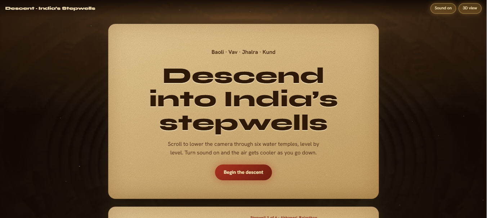
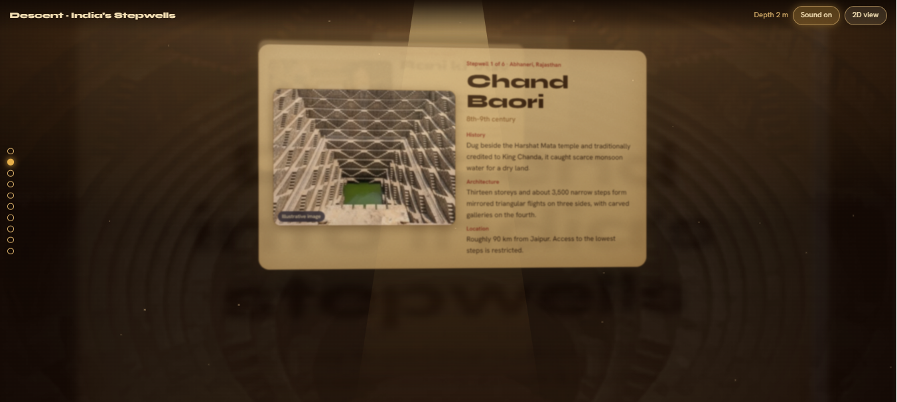
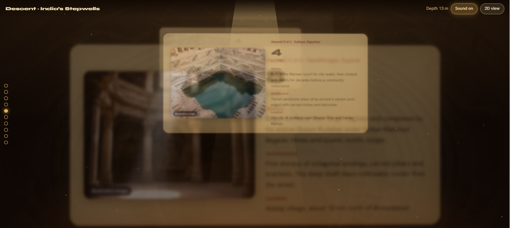
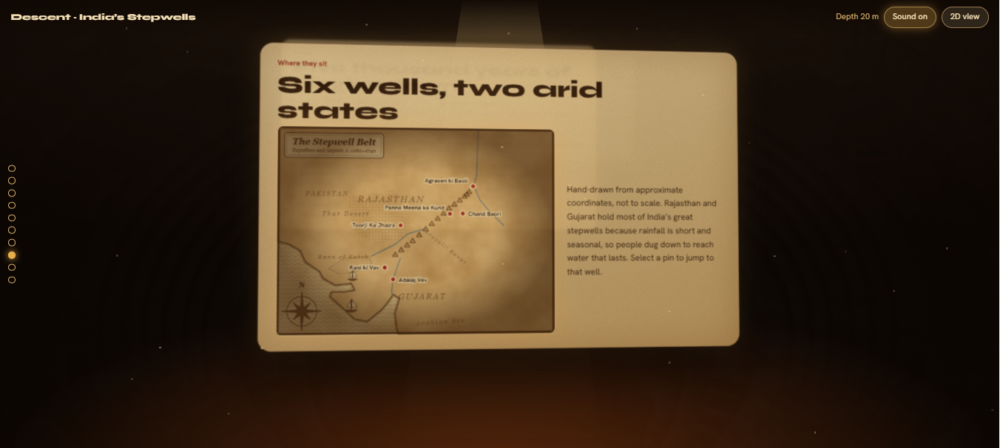

# Descent: India’s Stepwells

An immersive, scroll-driven gallery of India’s stepwells (baolis, vavs, jhalras and kunds). The page is a stack of floating parchment panels in 3D space. Scrolling lowers the camera down the shaft, one level at a time, while far panels blur and a synthesised ambient soundscape deepens.




## Screenshots

| | |
|---|---|
|  |  |
| Each stepwell gets a floating glass card with history, architecture and location. | Mid-scroll: panels at different depths, blurred by distance. |



*The map panel: a hand-drawn, parchment-style map of Rajasthan and Gujarat with clickable pins.*

## Features

- **Camera descent.** Scroll moves the camera through 10 levels using CSS 3D transforms. Depth-of-field blur and fade apply to far and passed panels.
- **Perspective tilt.** The whole scene follows the mouse, or the phone gyro on mobile.
- **Ambient audio.** A Web Audio drone and water drips get lower and cooler with depth. It is off by default; use the Sound button.
- **Six stepwells.** Chand Baori, Rani ki Vav, Agrasen ki Baoli, Adalaj Vav, Toorji Ka Jhalra and Panna Meena ka Kund.
- **Antique map.** An SVG map with coastline, Rann of Kutch, Thar Desert, Aravalli Range, rivers, compass rose and ships. Pins jump to each well.
- **Timeline and visit guide.** Eight milestones from Indus-era water engineering to UNESCO listing, plus six practical tips.
- **Ancient theme.** Parchment panels with paper grain, umber backdrop, golden light beam and drifting dust.

## Sections

1. Descent hero
2. Gallery of 6 stepwells
3. Map panel
4. Timeline
5. Visit guide

## Controls

| Input | Action |
|---|---|
| Scroll / trackpad | Move down or up the shaft |
| Arrow Down, PageDown / Arrow Up, PageUp | Next or previous level |
| Home / End | First or last level |
| Side dots | Jump to a level |
| Map pins (Enter or Space) | Jump to that stepwell |
| Sound button | Toggle ambient audio |
| 2D view button | Switch to a plain stacked layout |

## Accessibility

- A **2D fallback** (stacked cards, no transforms, blur or tilt) turns on automatically when the system asks for reduced motion, and can be toggled at any time.
- Full keyboard navigation with visible focus. Tabbing to a panel scrolls to it.
- Images have alt text, map pins are labelled buttons, and audio never starts by itself.

## Run locally

No build step. Open `index.html` in a modern browser. An internet connection is needed only for the Google Fonts (Syne, Hanken Grotesk); the page falls back to system fonts offline.

```bash
# optional: serve it
python3 -m http.server 8000
```

## Project structure

```
index.html            the whole site (HTML, CSS, JS, embedded images)
assets/images/        the source crops of the six wells and hero background
docs/screenshots/     screenshots used in this README
LICENSE
README.md
```

## Customising

Everything is data-driven from arrays near the top of the `<script>` in `index.html`:

- `W`: the six wells (name, place, year, history, architecture, location, and the fallback SVG settings).
- `T`: timeline entries. `G`: visit-guide tips.
- `PIN`: map pins as `[longitude, latitude, name, panel index, ...]`.
- `IMG`: the well photos, in the same order as `W`, as base64 data URIs. To swap one:

```bash
python3 -c "import base64;print('data:image/webp;base64,'+base64.b64encode(open('well.webp','rb').read()).decode())"
```

If an `IMG` entry is missing, that card falls back to the layered SVG drawing of the well.

## Notes on content

- Dates, dimensions and distances are approximate and drawn from general knowledge. Please verify them against a primary source such as the Archaeological Survey of India before publishing.
- The map coastline and features were traced by hand from approximate coordinates. It is illustrative, not survey-grade.
- The well images are **AI-generated illustrations**, labelled "Illustrative image" on each card. Replace them with licensed photographs and add credits if you want real photography.

## Built with

HTML, CSS 3D transforms, vanilla JavaScript, SVG and the Web Audio API. Fonts: Syne and Hanken Grotesk.

## License

MIT. See [LICENSE](LICENSE).
